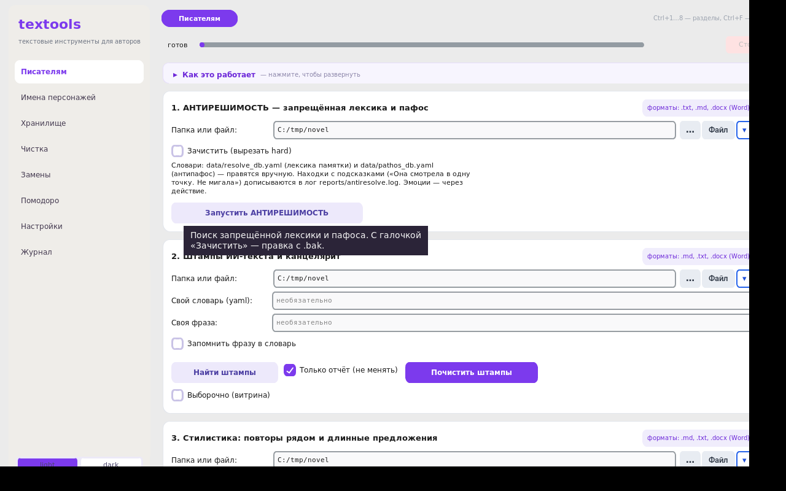
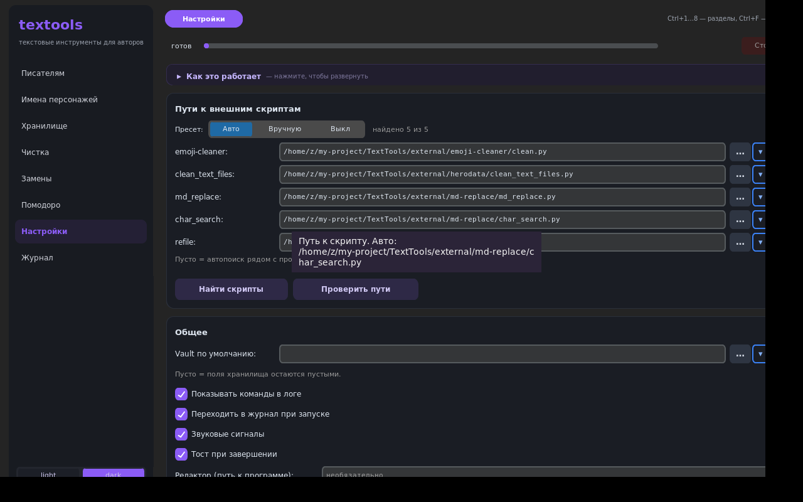
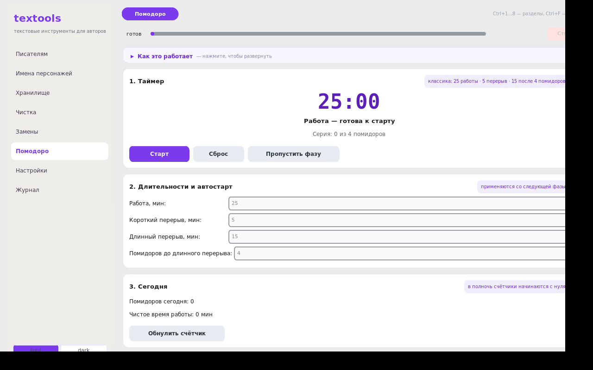
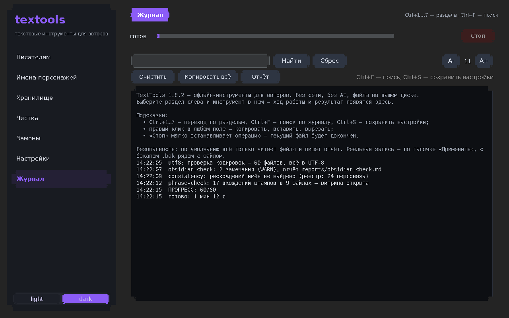

# TextTools

[Русский](README.md) · **English**

A desktop utility for one o'clock in the morning, when an author is
paging through their own book yet again — not because they want to,
but because somewhere in sixty files they renamed the heroine a month
ago and can no longer remember whether they did it everywhere. The
tool reads the whole text folder at once and tells you what is actually
going on in it: where one character got called by three names, which
notes hang without any inbound links, which links lead nowhere, where
emoji and CJK characters flew into the text, where an encoding turned
Russian letters into mojibake, where a paragraph consists of the same
word repeated. Then it fixes all of that, if you allow it. Re-reading
a manuscript to hunt typos is the kind of work you burn out on before
you finish the book; the program takes that work for itself.

There are no clouds, no subscriptions and no artificial intelligence
here. What there is: 34 CLI subcommands (35 names), a window with eight tabs,
and your folder of texts, to which all of it is applied.

Built for Russian-language prose in Obsidian: names and their
inflected forms, ё vs е, «Russian-style guillemets», dashes, clichés,
wiki-links. Since 1.8.5 English texts are processed too: the text
language is picked on the Settings tab (Russian/English), and stop
words, parasites, cliché dictionaries and name search follow it;
window strings switch per the pipeline in
[docs/LOC_PLAN.md](docs/LOC_PLAN.md). It reads `.md`, `.txt` and
`.docx` from local disk. It never touches the network unless you
explicitly ask it to update itself: since 1.9.0 there is a button on
the Settings tab, `python textools.py update`, and the update.bat
script — all of them pull fresh files from GitHub over the existing
installation while settings and logs stay put. Large vaults run under
fuses: oversized files are skipped, long scans stop on their own.

It was written for one repository and one author, not for a market.
Hence the occurrence showcase, the Stop button and a report before
every write — instead of onboarding flows and pricing tiers.

It does not make text better. It makes it consistent: one name in one
spelling, one kind of quote, one encoding, zero stray emoji. Whether
the text is any good remains the author's responsibility.

Documentation: [MANUAL.md](MANUAL.md) (scenarios and every button),
[GUI_GUIDE.md](GUI_GUIDE.md) (the window, step by step, no
programming knowledge required), [CHANGELOG.md](CHANGELOG.md) (what
changed and when), [TECH_DEBT.md](TECH_DEBT.md) (the project's
register of technical debt), [docs/AUDIT.md](docs/AUDIT.md)
(audit reports), [docs/STATUS.md](docs/STATUS.md) (the project's
current state), [docs/CLI_GUI_MAP.md](docs/CLI_GUI_MAP.md)
(CLI-to-GUI correspondence).
Check whether your copy is intact with
one command: `python textools.py doctor`. Version 1.9.2, Windows,
Python 3.10+, MIT license.

## Screenshots

The window in both themes, all 8 tabs: folder
[docs/screenshots](docs/screenshots/README.md) — with a table of
every shot.

| Writers (light) | Settings (dark) |
|---|---|
|  |  |
|  |  |

## In plain terms

A novel lives in a folder of sixty files, and it is no longer a
manuscript but a battlefield with yourself: somewhere in the middle
the hero got renamed, and now he is Семён in half the chapters and
Семен in the other half — the two spellings differ by a single ё,
and the eye has long stopped noticing. One beta reader sent a chapter
as a Word file in Windows-1251; an emoji sneaked into another
paragraph from a messenger. Quotes are sometimes «guillemets»,
sometimes "straight"; in places the dash is just a hyphen. The draft
still links to a chapter deleted in September. You know all of this —
and still don't fix it, because the eye sees one page at a time while
the mess lies across the whole folder, and a fifth eyeball pass
doesn't cure the book, it only feeds the feeling that you're taking
it seriously.

The program sees the folder as a whole and produces a list: these
twelve files still contain the old name, these three files are not
UTF-8, here are forty turns of phrase like "it is worth noting that",
this link leads to nothing. Then a checkbox — "Apply changes" — and
it edits, keeping a copy of every file it touches. A second run comes
back empty, and this is that rare evening when the text needs nothing
more from you.

## Who this is for

You want it if at least a couple of these hold:

* you have dozens or hundreds of texts, and they live in one folder;
* there are links between them, a shared cast list, and consistent
  formatting rules that must hold everywhere;
* you have caught yourself not remembering what you called the
  character in chapter three, and searching for it by re-reading
  chapters you have already read a dozen times.

You don't want it if you have five files and write in Word without
links. Ctrl+H is faster there, and the tool won't change that. It
starts paying off at the volume where memory stops being a reliable
index — not on the first short story, where everything still fits in
your head.

## The expected objection: "nobody needs this"

True. The program was written for one repository and one author, and
published because it was already written — it never set out to be a
product: zero downloads don't frighten it, it doesn't live off them.
But several habitual objections are worth dismantling letter by
letter — if only for whoever wandered in here by accident.

**"Word does all this — Ctrl+H and search."** For five files — yes.
For three hundred, Ctrl+H won't tell you how many times the hero
remained in his old name and in which grammatical cases; it won't
find the note nobody links to; it won't compare chapter against
chapter. Search sees one occurrence at a time, while the problem
lies at the scale of a folder. Here the report covers the whole
folder at once, and the second run is free.

**"A neural network would do it better."** A neural network rewrites
the text — that is a different job, and it brings a second problem:
fabrication. Running a hundred files through a model means a
subscription, a network connection, and a manuscript on someone
else's server, while the answer still has to be re-checked by hand:
the model is under no obligation to remember what the heroine was
called in chapter four. Here it is rules and dictionaries: the same
input yields the same report, the files never leave the disk, and
nobody "slightly improves" a paragraph on the side.

**"Hire a proofreader."** Worth doing — and hiring one is better. But
a proofreader edits the language of the page in front of them. The
through-line — what the heroine was called at the start, whether a ё
has been swallowed in "всё", whether a scene got duplicated — they
will only find by reading the whole cycle in order, and those are
paid pages. The program walks the through-line in minutes and for
free, leaving the proofreader the language instead of the
bookkeeping of names.

**"There are Obsidian plugins, aren't there?"** There are. This tool
is not a plugin: it works with a folder on disk, installs nothing
inside the vault, and does not depend on the editor's update cycle.
And it edits `.docx` and `.txt`, which Obsidian plugins usually don't
do at all.

**"Thirty-two commands — what on earth for."** You can keep the
command line closed forever: the window offers the same things as
buttons. The CLI is for people who run checks from a script or on a
schedule; everyone else can ignore it.

In short: the program does not compete with Word, Obsidian, a
proofreader, or a neural network. It takes one narrow boring strip —
the consistency of a hundred files — where all of the above is either
powerless, or expensive, or asks for the manuscript in the cloud. If
you don't have that strip, you don't need the program. That is not a
functional deficit; that is its boundary.

## What it solves

| The pain | What the tool does |
|---|---|
| A character is named three ways, and you can't tell typo from intention | `registry-builder` collects candidate names, `consistency` checks the texts against a YAML registry: old names, risky variants, typos. Inflected forms via pymorphy3; ё and е count as the same letter |
| No visibility of who appears in which chapter | `matrix` builds a "character × file" table |
| Orphan notes, dead links, duplicates | `orphan-finder`, `broken-links`, `merge-finder` |
| Obsidian silently breaks markup | `obsidian-check`: frontmatter, headings, tables, tags, code fences, links, text split character-by-character. Severity ERROR/WARN/INFO; `--fix` repairs the unambiguous and makes `.bak` |
| Copy-paste smuggled in emoji, CJK, mojibake | `cjk` (find_cjk) and `utf8`; `cjk` also checks `.docx` (line number = paragraph number). `obsidian-check` catches `ENC_NOT_UTF8`. Emoji are cleaned by an external script, see "What's not here" |
| The text went through a neural network and left traces: invisible watermarks, swapped characters | The emoji cleaner: `--ai-scan` is read-only and reports zero-width and tag characters (AI watermark carriers), mixed-script words ("аdон", "Oля"), hidden and white text in docx. `--invisible` strips invisibles, `--ws` normalizes spaces and tabs |
| Files arrived in cp1251, koi8-r or cp866 | `utf8` detects the encoding and converts to UTF-8, with a report and backup |
| Quotes, dashes and ellipses all over the place | `typography`: «guillemets» (including „inner quotes" and nested quotations), dashes, ellipses, dialogue dashes, optionally non-breaking spaces |
| Clichés and filler | `phrase_check` against the `phrases.yaml` dictionary; the showcase lets you pick occurrences instead of accepting everything wholesale. `check-all --plan` assembles a rehearsal of the cleanup — a single plan of clichés and ANTIRESONANCE before any edit |
| Nearby repetitions and half-page sentences | `style-report` (repetition window, long sentences), `stats` (volume, dialogue, filler words, CSV diary, `--history` — pace per day). `echo` catches "echo phrases" — repeated constructions across DIFFERENT chapters |
| The ё has gone missing: все/всё, небо/нёбо | `yo_audit`: dictionary pairs, homographs and names from the registry; replacement only at the places you pick; in docx — word by word across the whole document, preserving case |
| Beta readers live in Word | `export-docx` turns a .md chapter into .docx: headings → Heading styles, lists, quotes, [[wiki-links]] → aliases |
| Backups scattered across the folder | `restore` shows what can be brought back; `archive-backups` moves old copies into `archive/backups`. Nothing is ever deleted |

## Why it is built this way

**Report first, write later.** Every operation that changes files
runs in dry-run by default. Real writing is enabled by the "Apply
changes" checkbox or the `--fix` / `--yes` flags. A tool that edits
someone's manuscript is obliged to show what it intends to do.

**The backup is never overwritten.** A `.bak` is created once
(`backup_once`). A second run will not clobber the first copy:
otherwise the protection against mistakes becomes a way to lose data.
Cliché cleanup puts its copies in `md_replace_backups/<date-time>/`.

**Nothing is deleted.** Old backups are moved to `archive/backups`.
Restore finds `.bak` files and shows what it found before returning
anything.

**Morphology instead of name regexes.** pymorphy3 provides inflected
forms; ё and е count as one letter. Without this, "Семёна" and
"Семена" look like different people, and "Семёныч" is lost entirely.

**Dictionaries live apart from the code.** Clichés, filler words and
ё-pairs sit in `tools/*.yaml`. Your own clichés are added as text,
without touching Python. A dictionary file replaces the built-in set
entirely — it does not extend it.

**CLI and GUI share one core.** The CLI is convenient for scripts and
regular checks. The GUI is where a human makes the decision: the
cliché showcase, ё/е, picking individual occurrences. Both modes call
the same engines and produce the same reports.

**A long operation can be stopped.** The Stop button places a
`stop.flag`: the program finishes the current file and exits instead
of tearing a write in half. Fifteen seconds of patience, then a
forced shutdown.

**Local and offline.** There are no network calls in the code. The
texts stay on disk; nothing is sent anywhere.

## What's not here

**No AI.** No generation, no "style improvement". Dictionaries,
rules, morphology. If you expect the program to write a paragraph for
you, this is not the place.

**No editor.** It does not open notes for editing and does not
replace Obsidian. You edit the text in your own program; the utility
checks the files and puts them in order.

**No proofreader.** Spelling and punctuation in the LanguageTool
sense are not checked. Ё/Е, clichés and typography do not replace a
human read-through.

**`.docx` support is textual, but not total.** Reading and
replacements (clichés, ё/Е, spaces, dividers, typography) work across
the whole document: body, tables, headers/footers, footnotes,
comments — including phrases split across runs. Checks (`cjk`,
stylistics, ANTIRESONANCE, duplicates) also see docx. Limitations: a
replaced span inherits the formatting of its first affected fragment
(if the phrase was half italic, italics will not survive the
replacement); text inside Word tracked changes and field codes is
untouched.

**Five GUI buttons call external scripts.** Emoji cleanup,
mass-replace, character search, refile and clean_text are the
author's personal tools; they now ship inside the repository, in
`external/`, and the "Auto" preset finds them without configuration.
The emoji cleaner also handles invisible junk: `--invisible` strips
zero-width, bidirectional and tag characters, `--ws` normalizes
spaces and tabs, and `--ai-scan` only reads the text and reports AI
traces. In the GUI these are the "Invisible characters" and "Spaces
and tabs" checkboxes and the "AI traces (report)" button on the
emoji card. If the folder is empty or the scripts have moved, the
button honestly says "not configured": paths are set on the Settings
tab or carried over by `tools/bundle_external.py`. Check that all
five are present: `python textools.py doctor`.

**Not an Obsidian plugin.** It works with a folder on disk and does
not live inside the app. It does not sync the vault either.

**Not for macOS and Linux.** Written and tested on Windows. The
application interface itself is in Russian.

**Not a publisher.** No epub, no pdf, no layout. This is about the
state of the text, not about releasing a book.

**It does not fix everything silently.** Where a choice is needed
(clichés, ё/е, contested replacements), the program shows the
showcase and waits for a decision. There is no "smart" editing
without confirmation.

**No guarantee over every extension.** `.markdown`, `.MD` and
extensionless files are not handled by every tool. The report will
show what was left outside.

## Installation and first run

```
py -3.14 -m pip install -r requirements.txt
py -3.14 gui_ctk.pyw
```

An out-of-the-box check: `python textools.py doctor` — a fresh copy
will verify its own key files, dictionaries, dependencies, external
scripts and version consistency; exit code 0 means you can work.

A second way to launch: `textools_gui.bat` — before starting it pulls
updates from GitHub on its own (if the folder is a git copy and git
is in PATH; otherwise it simply runs as is). Which version is running
is visible in the window title.

A third way — `update.bat`: an update in one click. It pulls the code
(git, and without a network — a zip archive from GitHub), refreshes
the desktop shortcuts, disables the launchers of stale copies, and
prints the version before and after. The program has its own side of
this: the updater marks the canonical copy — the path is stored in
`%APPDATA%\TextTools\canonical.txt` — and if you start an old one,
from an old shortcut or an unpacked archive, it will tell you and
launch the fresh copy in its place. If the marker is stale, the
folder is gone or the file is missing, the program simply starts as
if nothing happened: the protection has no right to break an ordinary
launch.

If your desktop shortcuts lead to a previously downloaded copy (the
window opens but nothing updates), make a fresh shortcut: the "Create
fresh shortcut" button on the Settings tab, or
`python textools.py copy-doctor --new-shortcut`. It points at the
current copy and pulls updates itself through the bat file. To find
and deal with old copies wholesale — the "Find stale copies and
shortcuts" button in the same place; nothing is deleted, old files
move to marked folders.

On a machine with a single Python, write `python` instead of
`py -3.14`. `textools` works straight out of the project folder. You
don't need to install it into your global Python: the package
contains generic names `core`, `tools`, `wrappers`, and they could
shadow other projects' modules.

If you do want a system-wide `textools` command, install the package
into a separate environment:

```
py -3.14 -m venv .venv
.venv\Scripts\activate
pip install .
textools --version
```

Dependencies: `pyyaml`, `python-docx`, `customtkinter`, `pymorphy3`
(inflected forms of names), `charset-normalizer` (encoding
detection), `tkinterdnd2` (drag & drop of files into fields; without
it the program works, just without drag & drop). Package metadata in
`pyproject.toml`.

It is better to run the first pass on a copy, not on the working
vault:

1. Copy the notes folder somewhere separate, preferably temporary.
2. Check the copy of the tool: `python textools.py doctor`.
3. Launch the GUI and point it at the copy.
4. Run the read-only checks: "Integrity", "Obsidian validator",
   "Orphans", "Statistics".
5. Don't enable "Apply changes". Nothing will land on disk.

## CLI

```
python textools.py registry-builder --input <folder> [--registry <yaml>] [--min-count N]
python textools.py consistency      --input <folder> --registry <yaml>
python textools.py forms            --registry <yaml> [--fill]
python textools.py matrix           --input <folder> --registry <yaml>
python textools.py merge-registry   --candidates <yaml> --registry <yaml> [--add] [--names "name1,name2"]
python textools.py utf8             --input <folder> [--fix]
python textools.py orphan-finder    --input <folder>
python textools.py broken-links     --input <folder>
python textools.py phrase-check     --input <folder> [--clean --yes] [--out report.md]
python textools.py antiresolve      --input <folder> [--clean] [--log file] [--out report.md] [--json]
python textools.py check-all        --input <folder> [--out summary.md] [--plan plan.md] [--json summary.json]
python textools.py merge-finder     --input <folder>
python textools.py integrity        --input <folder>
python textools.py obsidian-check   --input <folder> [--fix] [--no-bak] [--exit-zero] [--out report.md]
python textools.py cjk              --input <folder> [--ext .md,.txt] [--json report.json]
python textools.py restore          --input <folder> [--restore] [--file <name>]
python textools.py archive-backups  --input <folder> [--days 30] [--move]
python textools.py moc              --input <vault> --registry <yaml> --out-dir <folder> [--apply] [--update]
python textools.py stats            --input <folder> [--out report.md] [--csv] [--history]
python textools.py yo               --input <folder> [--registry <yaml>] [--review] [--out report.md]
python textools.py export-docx      --input <chapter.md> --out <chapter.docx> [--force]
python textools.py echo             --input <folder> [--n 3] [--min-files 2] [--top 25] [--registry <yaml>] [--out report.md]
python textools.py typography       --input <folder> [--fix] [--nbsp] [--check]
python textools.py cast             --input <folder/file> [--out reports/cast_list.txt] [--min-count 1]
python textools.py name-check       --name "Title" [--out report.md]
python textools.py copy-doctor      [--fix] [--roots "folder1;folder2"]
python textools.py doctor           [--json report.json]
python textools.py style-report     --input <folder> [--registry <yaml>] [--window 5] [--long 25]
python textools.py whitespace       --input <folder> [--fix] [--keep-breaks]
python textools.py separators       --input <folder> [--fix] [--symbols ...] [--min-run 3]
python textools.py emoji-icons      --input <file/folder> [--fix] [--map icons.json]
```

Common options: `--out <file>` (report, "-" — to stdout for
pipelines), `--limit N`, `--verbose`, `--json <file|->` — a
machine-readable report (all checks; with "-" stdout is the JSON
entirely and the human-readable output goes to stderr). An empty or
nonexistent `--input` is an error with exit code 2. `antiresolve`
has the alias `pathos` — the same command, shorter. Analytical tools
(stats, style-report, phrase-check, echo, antiresolve, cast) also
read `.html`/`.htm` — the page text is extracted from the markup;
editing tools (typography, cleanups) do not touch html. Long
operations print progress lines `PROGRESS:N/M`; the GUI draws a bar
from them.

## GUI

A step-by-step guide to the window, every button and the working
scenarios: [GUI_GUIDE.md](GUI_GUIDE.md).

Tabs (the interface itself is in Russian; the English glosses are
here to help you navigate):

* **Writers (Писателям)**: ANTIRESONANCE (finding and cleaning
  inflated pathos), AI-text clichés (search, cleanup, interactive
  showcase), style report (word repetitions in close proximity, long
  sentences), text statistics
  (with a CSV volume diary and the --history dynamics), the ё/е
  audit (showcase), typography («guillemets», dashes, punctuation,
  non-breaking spaces) and the read-through report (issues by line),
  Word export, echo phrases
* **Character names (Имена персонажей)**: registry-builder,
  consistency, the mention matrix, inflected forms (pymorphy3),
  adding candidates to the registry, MOC notes for Obsidian (with
  updating existing ones, --update), the
  cast list outside the registry (cast), checking a made-up title
  for collisions (name-check, offline)
* **Vault (Хранилище)**: orphan-finder, broken-links (wiki and
  markdown links), merge-finder, note integrity (integrity), the
  Obsidian validator (obsidian-check), CJK and mojibake search
  (find_cjk), the "check everything" profile (six checks in one run)
* **Cleanup (Чистка)**: emoji, garbage/CJK, whitespace, encodings
  (UTF-8), junk scene dividers (///// **** ===== ———)
* **Replace (Замены)**: md_replace (4 modes), char_search, targeted
  single-word replacement, refile
* **Pomodoro (Помодоро)**: a writer's timer for the Pomodoro
  technique — 25 minutes of work, a 5-minute break, a long break
  after the series; phase auto-start, daily counters (pomodoros
  and clean working time), fully offline; durations and auto-start
  live on the Settings tab; no CLI command (an interactive timer
  has nowhere to draw its countdown in a terminal)
* **Settings (Настройки)**: paths to external scripts, theme, fonts
  and UI scale, timings (toast, Stop, showcase), log line wrapping
  and opening the report after saving, Pomodoro timer settings
  (durations, series, auto-start), note checks (extensions for
  CJK, validator `.bak`), backup housekeeping, finding stale copies
  and creating a fresh shortcut (copy-doctor), general parameters,
  about the program, dependency checks and the full doctor check
* **Log (Журнал)**: tool output, search with highlighting, clearing,
  copying, saving a report, font scaling

Every field and button has a tooltip. A button's color carries
meaning: a calm grayish blue is a normal run (files are not changed
by default), purple is a key action that creates files ("Export to
Word", "Save now"), red is a real write (it appears the moment
"Apply" is enabled or dry-run is switched off), a blue outline with
the "▸" arrow opens a window or list (the ё/е showcase, the log,
folders) without launching anything. Long operations show progress in
the status strip above the tabs: a real counter "12/45" or a pulse
while the tool hasn't reported a percentage.

While an operation runs, the tool buttons are locked; a second
parallel run is impossible. Toasts appear bottom-right with the
system error or completion sound; the status shows the tool name and
the elapsed time. Any path can be pasted with a right click ("Paste
from clipboard", quotes are stripped); the field history keeps up to
50 recent paths (the limit is configured on the Settings tab).
Hotkeys: Ctrl+1…8 for the tabs, Ctrl+F for log search, Ctrl+S to save
settings. Window size and the last open tab are restored on launch.

**Safety:** write operations run in dry-run; a real write happens
only through the "Apply changes" checkbox. Backups are made before
writing (`.bak` nearby or `md_replace_backups/<date-time>/`).
Restoration lives on the Settings tab.

## Scope and encodings

* Orphans, broken links, duplicates and `obsidian-check` look at
  `.md` notes. Replacements and cleanup read `.md`, `.txt` and
  `.docx` wherever a tool supports it. The service directories
  `.obsidian`, `.git`, `md_replace_backups`, `.trash`,
  `.smart-env` are skipped.
* cp1251, KOI8-R, cp866 and UTF-16 are usually recognized, but some
  cleaning tools read only UTF-8 and skip such files. Run "Check
  encodings" / `utf8` first, then the rest of the cleanup.
* Recoding is never applied to `.docx`: it is a zip container.
* `find_cjk` returns exit code 1 when it finds something, not on
  failure. The GUI shows "issues found". `--exit-zero` remains for
  the CLI and external checks.
* The GUI config lives in `gui_config.json` (paths, theme, checkbox
  states, the external-script preset `script_preset`: `auto`,
  `manual` or `off`; UI scale and fonts `ui.scale`/`ui.font_*`; the
  editor `ui.editor`; timings `toast_ms`, `stop_wait_sec`,
  `review_timeout_min`; the path-history limit `path_history_limit`).
  Only `gui_config.example.json` goes into git.

## Repository layout

* `core/`: text parser, name registry, vault scanner, docx (including
  cross-run replacement), morphology (pymorphy3), encodings
* `tools/`: command engines (registry_builder, consistency,
  orphan_finder, broken_links, merge_finder, integrity_check,
  obsidian_check, phrase_check, antiresolve, whitespace_clean,
  separator_clean, utf8_convert, full_check, morph_forms,
  character_matrix, registry_merge, backup_restore, backup_archive,
  moc_builder, text_stats, typography, style_report, icon_replace,
  yo_audit, echo_finder, export_docx, cast_list, name_check,
  copy_doctor, app_check)
  and dictionaries `phrases*.yaml`, `parasites.yaml`; `yo_dict.yaml`
  is an optional dictionary of ё-pairs (without it a built-in list is
  used)
* `data/`: YAML dictionaries of ANTIRESONANCE rules (`resolve_db.yaml`,
  `pathos_db.yaml`, attribution in `SOURCES.md`);
  `name_alerts.yaml` — an offline reference of taken titles for
  name-check
* `find_cjk.py`: search for CJK characters, mojibake and encoding
  corruption (CLI `cjk`, a card on the Vault tab)
* `wrappers/`: building command lines for the external scripts
  (emoji-cleaner — with invisible-cleanup modes and an AI-trace
  report, md-replace, char_search, refile, clean_text_files).
  The scripts themselves live in `external/` inside the repository —
  the "Auto" preset checks it first. Next — beside the project (the
  base folder can be set with the `TEXTOOLS_SCRIPTS_DIR` variable);
  the Settings tab lets you set the path manually. Personal copies
  are carried into `external/` by `tools/bundle_external.py`: run it
  in your folder with a copy of TextTools — the scripts land in the
  repository, then an ordinary commit
* `gui_ctk.pyw`, `tabs_*.py`, `widgets_ctk.py`, `review_dialog.py`: GUI
* `GUI_GUIDE.md`: a step-by-step guide to the program window
* `pyproject.toml`: project metadata (version, description,
  dependencies, the `textools` entry point)
* `reports/`: output reports (not in git)

## Tests

The main suite is pytest:

```
python -m pytest test/ -q             # 342 tests: engines, CLI, docx, pomodoro, GUI utilities, language, updater, fuses, AI traces
```

The GUI is checked by separate scripts in the root (they open a
window):

```
python test_gui.py                    # all GUI tabs and buttons
python test_settings.py               # GUI settings: applied and clickable
python test_gui_fit.py                # button-row fit (scales 1.0 and 1.25)
python test_gui_buttons.py            # button geometry + the docs/BUTTONS.md schema
python test_gui_smoke.py              # smoke run of the window
python test_script_presets.py         # script auto-discovery and presets
```

The old synthetic suite lives in `archive/` and is run manually
(`python test_engines.py` from its folder) — it was written for the
former interface and is excluded from the automated checks. The
suites work on their own temporary or demo data; the launch order
doesn't matter. For manual runs there is the local playground
`test/demo_garbage/`. Details in `archive/README.md`.

## License

MIT, see [LICENSE](LICENSE). © 2026 DarkDaro.
